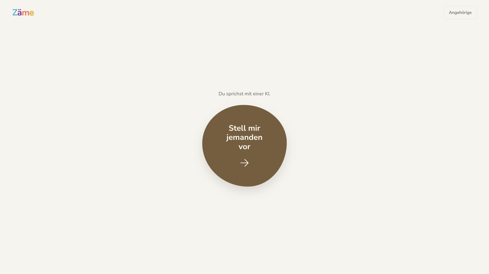
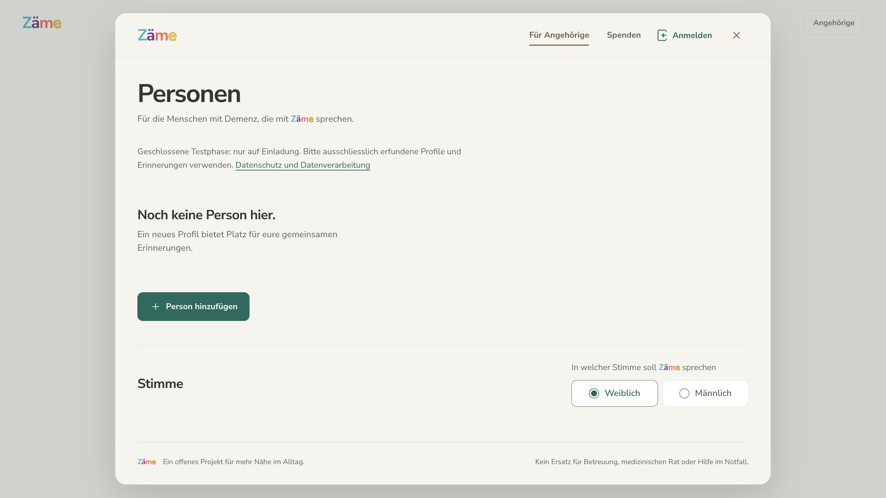

# Zäme

**Vertraute Gesprächsmomente. Gemeinsam Erinnerungen bewahren.** 
**Familiar conversations. Shared memories.**

[Deutsch](#deutsch) · [English](#english)

> **Ein offener Prototyp — nur mit erfundenen Profilen testen.**
> Zäme ist nicht für den Einsatz in Betreuung oder Medizin freigegeben. Datenschutz, Anbietervereinbarungen und die Eignung für echte Personen müssen vor einem solchen Einsatz geklärt werden.
>
> **An open prototype — test with fictional profiles only.**
> Not approved for care or medical use. Privacy, provider agreements and suitability for real-person use still need review.

## Deutsch

«Zäme» bedeutet auf Schweizerdeutsch «zusammen». Die Idee: ein einfacher KI-Gesprächsbegleiter für Menschen mit Demenz, der an vertraute Interessen und gemeinsame Erinnerungen anknüpft. Angehörige bereiten ein kleines Freundschaftsbuch vor; auf der Startseite genügt ein grosser Gesprächsknopf.

### So funktioniert’s

1. Ein Freundschaftsbuch für die Person anlegen.
2. Gemeinsame Erinnerungen als kleine Textnotizen sammeln.
3. «Wer bin ich?» aktualisieren und den Vorschlag prüfen.
4. Personen und eine Stimme auswählen.
5. Ein Gespräch beginnen — ohne komplizierte Bedienung.

Mehrere Personen können teilnehmen. Zäme weiss aber nicht zuverlässig, wer gerade spricht. Gespräche verändern die Bücher nicht automatisch.

Die Bücher bleiben unverschlüsselt im jeweiligen Browser, ohne geräteübergreifende Synchronisierung. Für KI-Funktionen werden ausgewählte Inhalte an die eingerichteten Anbieter übermittelt. Bitte keine Gesundheitsdaten oder vertraulichen Angaben verwenden. Zäme ersetzt keine menschliche Begleitung, medizinische Beratung oder Notfallhilfe; KI-Antworten können falsch oder belastend sein. Ein gesundheitlicher Nutzen ist nicht nachgewiesen.

## English

“Zäme” means “together” in Swiss German. It explores a simple conversation companion for people living with dementia, built around familiar interests and shared memories. Care partners prepare a little friendship book; the home screen keeps things simple with one large conversation button.

Create a book, add text memories, review the proposed summary, choose participants and a voice, then start talking. Several people can join, but speaker identification is not reliable. Conversations never automatically update the books.

Books stay unencrypted in the current browser without synchronization. Selected content goes to the configured AI providers. Use fictional data only, not health information or confidential material. Zäme does not replace human care, medical advice or emergency services. No clinical benefit has been established.

## Open source & self-hosting

Different setups are possible, including **Infomaniak** and **Modal** for the language model. The main voice path uses **ElevenLabs Agents**; a separate classic adapter remains for private development. Provider use may incur costs. The software licence includes no hosting, service credits or endorsement.

The authenticated setup includes invitations, consent checks and deletion handling. It requires your own identity provider, credentials, budget and reviewed legal documents. No public test service or operator affiliation is bundled with this repository. Donation figures are explicitly labelled demos; payments are not connected.

Code: [MIT licence](LICENSE). Icons: [Iconoir](icons/LICENSE). Font: [Nunito Sans](fonts/LICENSE.txt). Please keep profiles, recordings, private links and credentials out of public issues. For sensitive findings, see [Security](SECURITY.md).

[Development](docs/DEVELOPMENT.md) · [Project status](docs/PROJECT-STATUS.md) · [Self-hosting](docs/ZITADEL-LOGIN.md) · [Donation demo](DONATIONS.md)
